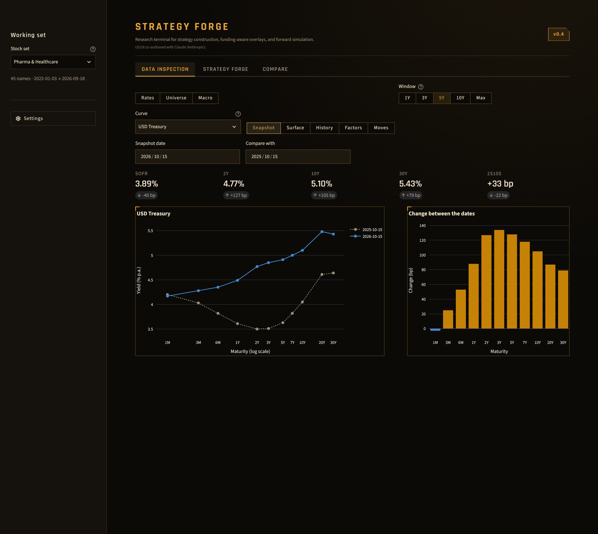
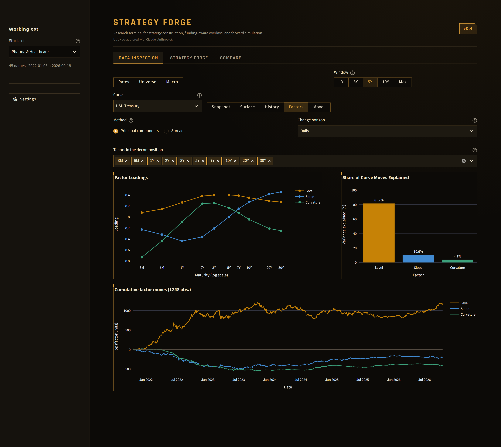
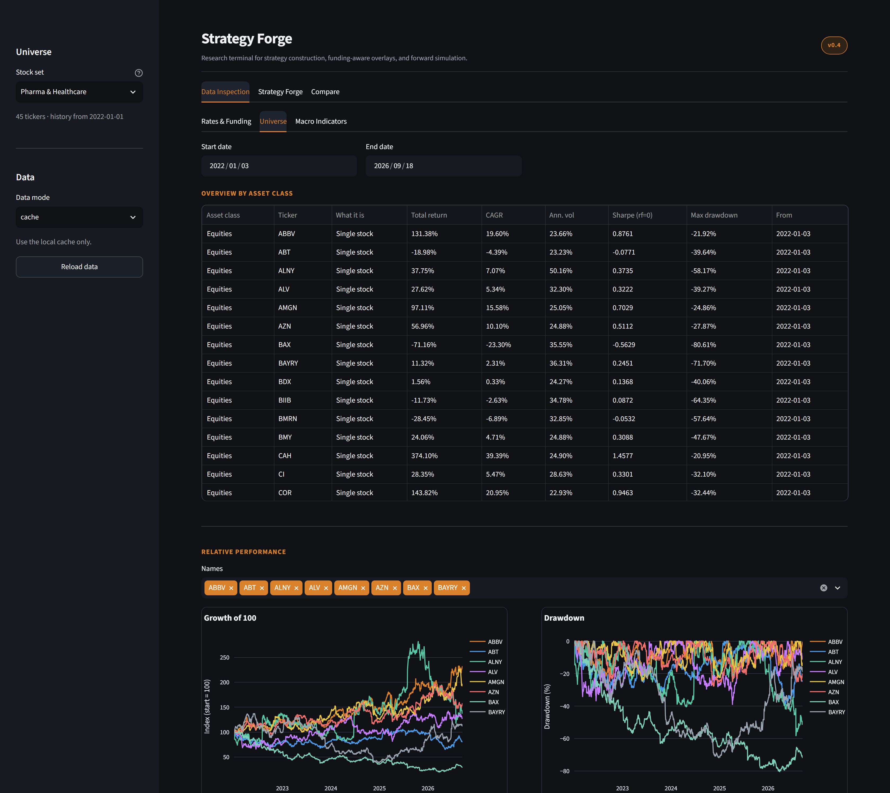
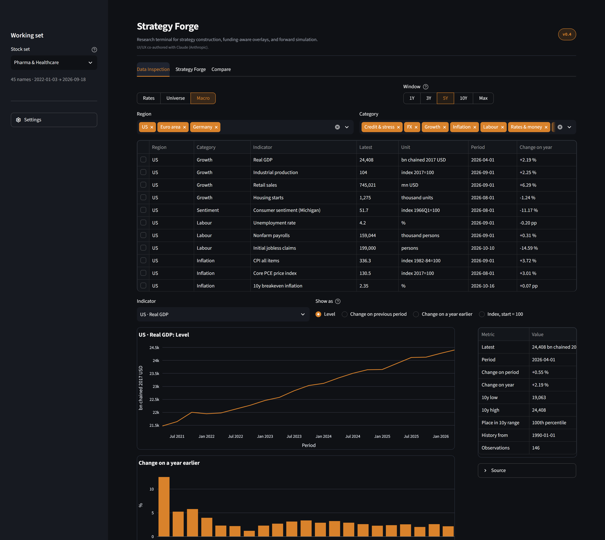
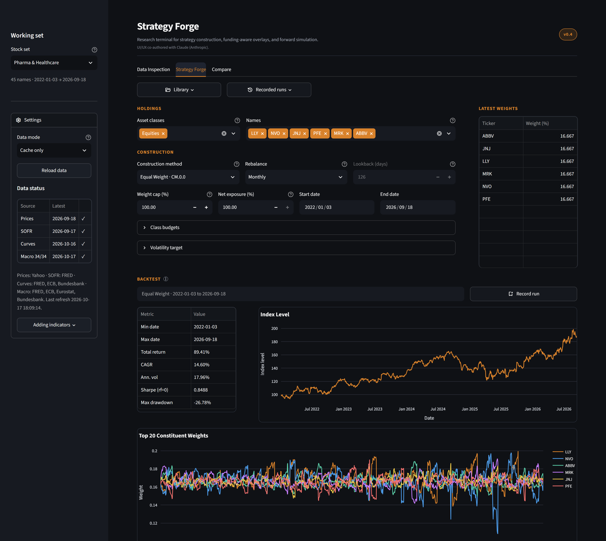
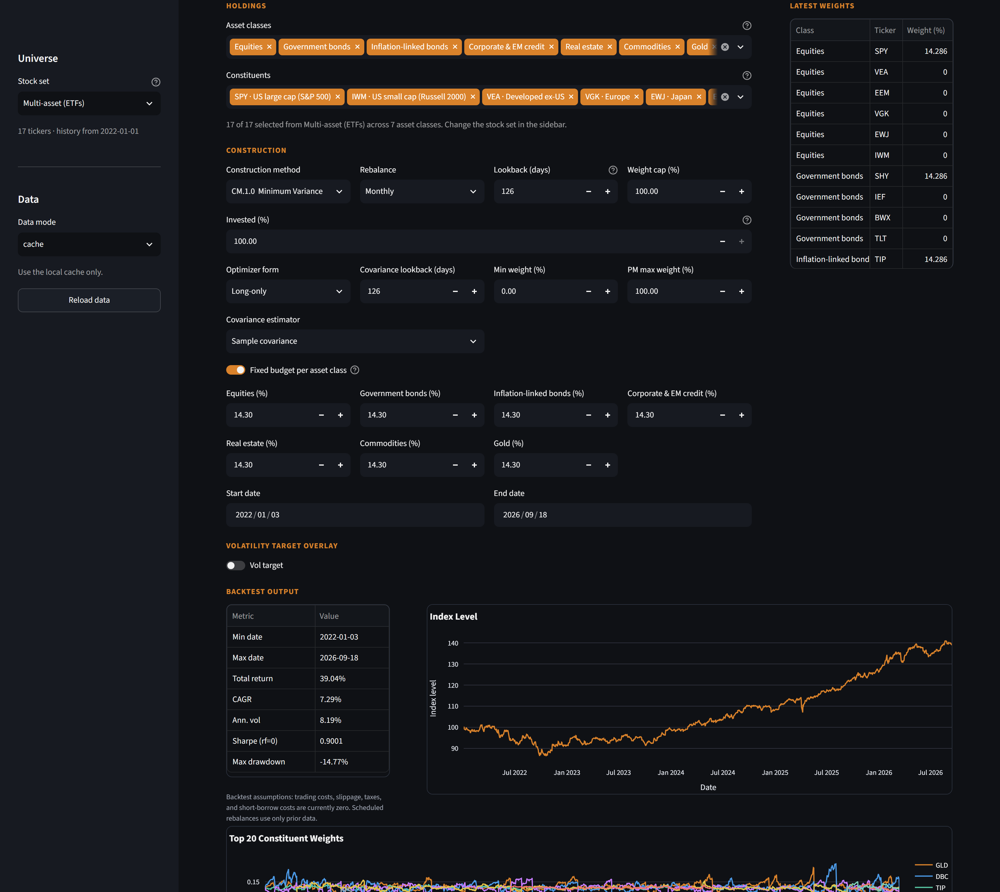
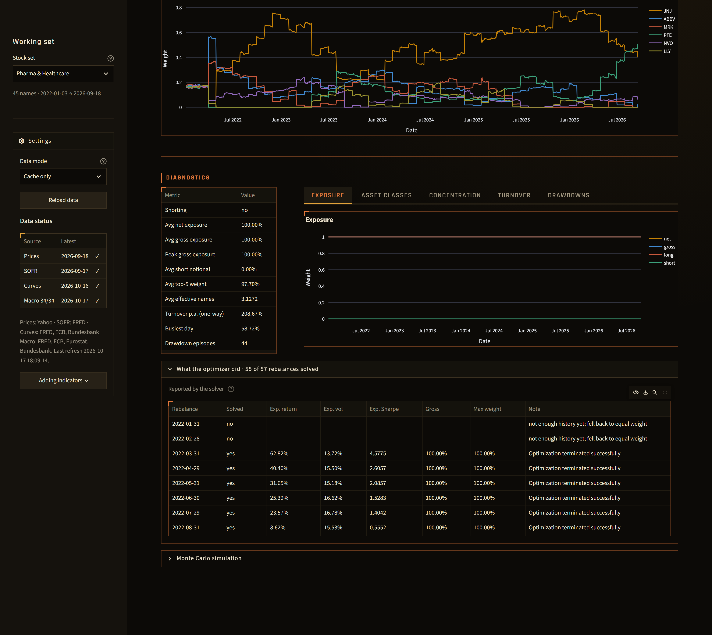
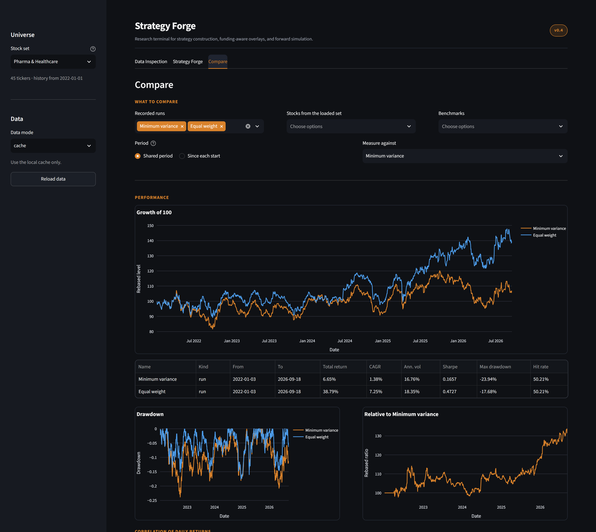
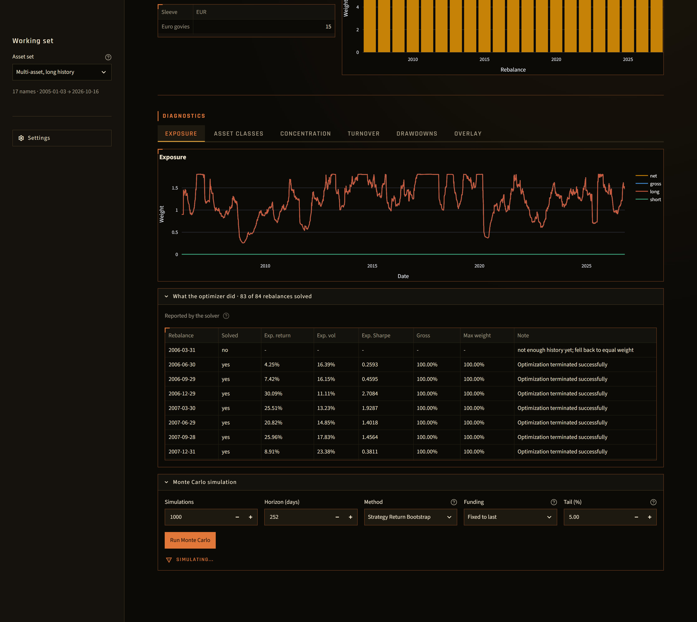

# Strategy Forge

A Streamlit research terminal for building systematic equity and multi-asset
strategies, saving them, re-running them, comparing them, and working out why
they behaved the way they did. Alongside it sits a data inspection layer for the
USD curve, the stock sets and a catalogue of macro indicators.

> UI/UX co-authored with Claude (Anthropic).

It covers passive construction rules and the PM classics, funding-aware
volatility targeting, forward simulation, and a persistence layer that separates
the logic of a strategy from any one execution of it.

Repository: <https://github.com/CalaveraJack/portfolio_balancing>

---

## 🚀 Quick start

### 1) FRED API key

The rates data and the funding-aware overlay come from FRED.

- Create an account at <https://fred.stlouisfed.org/> and generate a key
- Put it in a `.env` file:

```bash
FRED_API_KEY=your_api_key_here
```

`.env` is gitignored. Treat the key like a password and never commit it.

### 2) Install

```bash
uv venv
uv sync
```

### 3) Run

```bash
uv run streamlit run app.py
```

Open the URL Streamlit prints (by default <http://localhost:8501>).

### Sidebar

Only what applies to every tab:

- **Working set**: the stock set Universe, Strategy Forge and Compare use, with
  its real date range.
- **Settings** (closed by default): data mode, **History from** (2022 to
  1990), reload, and **Data status**, the latest observation of every source
  and any failures. History before 2022 needs one refresh the first time.
  Before SOFR (April 2018) cash earns the effective fed funds rate.

| Data mode | Behaviour |
| --- | --- |
| Cache only | Never call external APIs; read the local cache only. |
| Refresh, fall back to cache | Fetch fresh data, fall back to the cache if that fails. |
| Refresh, fail on errors | Fetch fresh data; stop on price or rates errors. |

Macro and curve failures never stop the app; they show in Data status and as a
warning on the affected view.

Controls that need explaining carry an info button (ⓘ / ?).

---

## 🧭 The three tabs

| Tab | What it is for |
| --- | --- |
| **Data Inspection** | Rates, Universe and Macro, chosen with pills, over one shared window (1Y to Max) |
| **Strategy Forge** | Build, save, backtest, diagnose and simulate a strategy |
| **Compare** | Recorded runs, single stocks and benchmarks side by side |

### Rates

Pick a curve, **USD Treasury** (FRED), **EUR AAA government** (ECB) or **German
Bunds** (Bundesbank), each with its funding rate (SOFR or €STR). Then one of
four views:

- **Snapshot**: two dated curves, the change between them, and key levels.
- **Over time**: the whole curve as a 3D surface or a heatmap (of yields, or of
  changes over 21 trading days), and beneath it the same picks as slices: the
  chosen tenors through time, the overnight rate as a dashed line, and one
  spread shaded between its legs with a strip that turns blue when inverted.
  The tenors picked are also drawn on the surface, with the Snapshot curve.

- **Factors**: level, slope and curvature, either as principal
  components of yield changes (loadings, variance explained, cumulative factor
  moves) or model-free from the 2y, 5y and 10y. The 1-month bill is left out of
  the PCA by default; it moves on bill supply and debt-ceiling news and would
  otherwise take over the second component.
- **Moves**: every daily, weekly or monthly move of a short/long pair
  (2s10s, 3m10y, 5s30s, 2s30s) named as a bull or bear steepener or flattener,
  a twist, or a parallel shift, with how often each happened and how large it was.





### Universe

Four views: an overview grouped by asset class (return, volatility, Sharpe,
drawdown per name); performance (growth of 100 and drawdowns for up to eight
names); correlation of daily returns ordered by class; and a single name.



### Macro

A catalogue of 34 indicators for the US, the euro area and Germany: growth,
labour, inflation, sentiment, rates and money, credit and stress, FX. The
catalogue table shows each one's latest reading and change on the year; click a
row to open it. The inspector shows one indicator as a
level, a change on the previous period, a change on a year earlier, or indexed
to 100, with a complementary second chart, key figures (including where today's
value sits in its ten-year range) and a CSV download.

Changes are computed on the full history before cutting to the window. A
level changes in percent; a rate (unemployment, a yield) in percentage points.



### Stock sets

The sidebar picks which stocks are loaded. Three ship with the app:

| Set | Names |
| --- | --- |
| Pharma & Healthcare | 45 |
| Mega-cap Core | 10 |
| Diversified + ETFs | 21 |
| Multi-asset (ETFs) | 17 |
| Government bonds (synthetic) | 12 |
| Multi-asset, long history | 11 |

Switching reloads the data and clears selections made against the previous set,
since they are not valid against the new one.

Stock sets are identified internally by a stable key, never by the name on
screen, so a label can be reworded without orphaning anything saved against it.
Definitions live in `index_lib/config/universes.py`.

### Asset classes

Every ticker belongs to one of seven asset classes: equities, government bonds,
inflation-linked bonds, corporate & EM credit, real estate, commodities, gold.
ETFs are tagged in `index_lib/config/asset_classes.py`; anything untagged is a
single stock and so an equity, which is why the equity sets need no tagging.

**Synthetic government bonds.** `UST2Y` to `UST30Y`, `DE2Y` to `DE30Y` and
`EUAAA2Y` to `EUAAA30Y` are constant-maturity bonds priced from the yield
curves: exact daily repricing with coupon income and roll-down. They track
SHY, IEF and TLT within 0.1–0.4 pp a year after fees since 2002, and reach
back to 1990 (Treasuries), 1997 (Bunds) and 2004 (EUR AAA). EUR bonds are in
local currency. They stand in for real bond data, which will replace them
under the same ids. Method, validation and limitations: `docs/BONDS.md`.

The **Multi-asset (ETFs)** set holds proxies for each class: SPY, IWM, VEA, VGK,
EWJ, EEM; SHY, IEF, TLT, BWX; TIP; LQD, HYG, EMB; VNQ; DBC; GLD. Bond returns
are total returns from the adjusted close.

---

## 🧩 Building a strategy



### Construction methods

#### Passive rules

- Equal Weight
- Cap Weight
- Price Weight
- Inverse Volatility

#### PM classics

- Minimum Variance
- Risk Parity / ERC
- Maximum Sharpe
- Maximum Diversification

Optimizers run **long-only or long/short**. Long/short exposes net exposure,
maximum gross exposure and a short borrow spread. Shorting is financed at the
loaded SOFR plus that spread, the same way the volatility overlay finances
leverage — so a zero spread is not free, it is SOFR. The rate reaches the
optimizer as well as the charge, so a return-seeking method will short less when
financing is dear. Note that a book with net and
gross exposure both at 100% cannot short at all: shorting requires gross above
net.

Covariance estimators: **sample**, **EWMA**, **Ledoit-Wolf**, **OAS**.

### Holdings and asset classes

Pick asset classes first, then the holdings within them. Adding a class adds all
of its holdings; removing one removes them. A set spanning several classes opens
with all of its names selected.

### Class budgets

An optional fixed share of the invested book per asset class, for example 60%
equities, 30% government bonds, 10% gold. The construction method then runs
*inside* each class on its own, as though that class were the whole book: equal
weight among the equities, risk parity among the bonds, and so on. Caps and
limits apply within a class.

Budgets are restored at every rebalance and drift in between. They are scaled to
add up to 100%. A class with a budget but no holdings has its budget shared out
over the others, and a class with holdings but no budget gets no weight; the app
says so in both cases.

A budget is a rule, so it is saved with a **strategy**, not only with a
portfolio. Strategies saved before v0.4 load without budgets and behave exactly
as before.



### How much is invested

**Net exposure** decides how much of the book is in the strategy; the rest sits
in cash earning SOFR. At 100% there is no cash leg and nothing changes. It is one
control for both forms: for long-only it is the invested fraction (up to 100%),
for long/short it is longs minus shorts. Long-only means no shorting, not fully
invested, so a long-only book may hold cash.

Exposure is reported as it actually is, including the volatility overlay: a book
running at 0.34x shows as 34% exposed, not 100%.

### Rebalancing and constraints

Rebalance daily, weekly, monthly or quarterly. Weights drift between rebalances.

Constraints available: a construction-level weight cap with automatic
redistribution, a per-method maximum weight, a minimum weight, and the
exposure limits above. Where the construction cap and the method maximum
disagree, the stricter of the two binds.

Not yet available: per-name short-side caps.

### Funding-aware volatility targeting

An optional overlay that scales the whole strategy return stream without
touching the construction weights:

- λ < 1 — the uninvested part earns the cash rate
- λ > 1 — the borrowed part pays SOFR plus your borrow spread

You set the target volatility, the volatility lookback, minimum and maximum
leverage, and the borrow spread.

---

## 💾 Saving your work

The **Library** and **Recorded runs** buttons at the top of the Strategy Forge
open saved work. **Record run** sits under the backtest it records; a run left
unnamed is named after its method and dates.

Three different things can be kept, and the difference between them is the point.

### Strategy

Construction logic only — method, rebalance, constraints, covariance estimator,
overlay settings. It carries **no stocks and no dates**, so the same logic can be
re-run on any stock set over any period.

### Portfolio

The same logic **plus the stocks you picked**. Reopening one restores the stock
set as well, switching the sidebar if needed.

Saving with or without the stocks is a toggle beside the Save button, and the
button says which one you are about to do. A portfolio naming a stock that has
since left the data loads the rest and tells you which one it dropped.

### Run

One historical execution: the logic, the stocks, the dates, **the results**, and
which data produced them. A run is a record rather than a definition — it is
never edited, and reopening it shows the numbers exactly as they were.

If the price data has been refreshed since a run was recorded, the app says so
and offers a choice with the cost of each stated:

- **Re-run** picks up corrections and any history added since, but the figures
  move, so anything you concluded from that run may change.
- **Keep it** preserves the record and keeps it comparable with other runs of the
  same vintage, but it may rest on data that has since been corrected and it
  stops at the older end date.

Everything is written under `saved_strategies/` as JSON and parquet, on your
machine only — the folder is gitignored.

---

## 🔬 Diagnostics

Alongside the performance statistics, every backtest reports:

- **Exposure** — net, gross, long and short over time. Net and gross coincide for
  a long-only book and separate as soon as it shorts.
- **Asset classes** — weight by class over time, and each class's average and
  latest weight against its budget.
- **Concentration** — weight in the top five positions, the Herfindahl index, and
  the effective number of equally weighted holdings (its reciprocal).
- **Turnover** — one-way, halved because every sale funds a purchase.
- **Drawdowns** — the deepest episodes with start, trough, recovery and depth.
- **What the optimizer did** — for the PM classics, what the solver reported at
  each rebalance: the return and volatility it expected from the weights it
  chose, its gross exposure, the maximum weight that bound, and whether it solved
  at all.

Those expected figures come from the estimates the optimizer worked with, not
from what was realized. They say what it was aiming at, not what it achieved.



---

## ⚖️ Comparison

A benchmark is a role, not a type. A recorded run, a single stock and an index
ETF are all a named series of levels, so any of them can sit on either side of a
comparison.

Align over the **shared period**, which is like for like, or **since each start**,
which shows full track records but over different market environments.

Outputs: rebased growth, drawdowns, a performance table (CAGR, volatility,
Sharpe, maximum drawdown, hit rate), relative performance against a baseline you
choose, and the correlation of daily returns.

The built-in benchmarks:

| Group | Tickers |
| --- | --- |
| Broad market | SPY, QQQ, IWM, ACWI |
| Sectors | XLK, XLV, XLF, XLY, XLP, XLE, XLI, XLB, XLU, XLRE, XLC |
| Factor & style | MTUM, QUAL, USMV, VLUE, SIZE |
| Other assets | TLT, IEF, GLD, DBC |

These are downloaded on demand. In `cache` mode only those already cached are
available, and the app names the ones that need a refresh.

Comparison works on **recorded runs**, so record a run before comparing it.



---

## 🎲 Monte Carlo simulation

Forward simulation that respects the construction method, simulating asset
returns, rebalancing, weight drift, volatility targeting and the funding overlay.



### Engines, by construction method

**Passive rules** (Equal, Price, Inverse Volatility) — constituent block
bootstrap, or correlated GBM.

**Cap Weight** — constituent block bootstrap only. It samples historical
constituent-return rows together with the aligned historical market-cap rows at
simulated rebalance dates, which keeps the cap state tied to observed market
structure rather than a static latest-cap vector. GBM is disabled here because
the engine does not simulate shares outstanding, corporate actions or cap-rank
dynamics.

**PM classics and class budgets** — strategy return bootstrap. These resample the realized strategy
return stream produced by the historical backtest, rather than re-optimizing
inside every simulated constituent path. Pathwise re-optimization is not
implemented. A book with class budgets takes this route too, since the
constituent engines apply one weighting rule across every name.

### Funding

Two independent stochastic layers. The asset process is one of the engines above;
the funding process is fixed at the last observed SOFR, an OU-inspired
mean-reverting process estimated from SOFR, or a bootstrap that preserves
empirical rate shocks. Simulated funding paths can be inspected individually
against the mean.

---

## ⚙️ Methodology

### Portfolio return

$$
R_t^{port} = w_t^T r_t
$$

Names without a price on a given day are treated as **stale, not sold**: the
position is carried forward at unchanged value and keeps its place in the book,
while the day's return comes only from the names that actually priced.

### Volatility targeting

$$
\lambda_t = \frac{\sigma_{target}}{\hat{\sigma}_{t-1}}
$$

### Funding-aware overlay

$$
R_t^{VC} = \lambda_t R_t^{port} + \max(1-\lambda_t,0) \cdot r_t^{cash} - \max(\lambda_t-1,0) \cdot r_t^{borrow}
$$

### GBM

$$
x_t = \log(1 + r_t)
$$

$$
x_t^{sim} = (\mu - 0.5 \cdot diag(\Sigma)) + L z_t
$$

$$
r_t^{sim} = e^{x_t^{sim}} - 1
$$

### Bootstrap

Block sampling:

$$
r_{t_1}, \ldots, r_{t_1+L-1}, r_{t_2}, \ldots
$$

### Cap-weight bootstrap

At simulated rebalance dates:

$$
w_{i,t}^{cap} = \frac{MCAP_{i,t}}{\sum_j MCAP_{j,t}}
$$

If every sampled market cap is unavailable for a simulation row, that row falls
back to equal weight.

### Class budgets

With budgets $b_k$ (summing to one) and invested fraction $f$, the target weight
of holding $i$ in class $k$ is

$$
w_i = f \cdot b_k \cdot w_i^{(k)}
$$

where $w^{(k)}$ is what the construction method gives when run on class $k$
alone.

### Curve factors

Principal components of the covariance of yield changes $\Delta y_t$ (in bp).
Signs are fixed so that level is positive when yields rise, slope when the long
end rises against the short end, and curvature when the belly (2y to 10y) rises
against the wings. The paths shown are cumulative projections of the changes on
the loadings.

### Curve moves

For a short and a long tenor with changes $\Delta s$ and $\Delta l$:

$$
\Delta \text{level} = \tfrac{1}{2}(\Delta s + \Delta l) \qquad
\Delta \text{slope} = \Delta l - \Delta s
$$

Bull or bear is the sign of the level change, and steepener or flattener is the
sign of the slope change. Opposite signs at the two ends make a twist, and a
slope change inside the band (1 bp by default) makes a parallel shift. Windows
do not overlap.

### Diagnostics

$$
\text{net} = \sum_i w_i \qquad \text{gross} = \sum_i |w_i| \qquad \text{HHI} = \sum_i w_i^2
$$

$$
\text{turnover}_t = \tfrac{1}{2} \sum_i |w_{i,t} - w_{i,t-1}|
$$

---

## 📦 Data and caching

| Source | What | Cache |
| --- | --- | --- |
| Yahoo Finance | Close and volume | `data/*.parquet` |
| Yahoo Finance | Market caps, sector metadata | `data/*.parquet` |
| FRED | SOFR, effective fed funds, and the Treasury curve | `data/*.parquet` |
| FRED, ECB, Eurostat, Bundesbank | Macro indicators | `data/macro_series.parquet` |
| FRED, ECB, Bundesbank | Inspectable curves, SOFR, €STR | `data/curves_series.parquet` |

### Macro indicators

Every indicator is one row of `index_lib/config/macro_catalogue.csv`: id, name,
category, region, frequency, kind (level or rate), unit, and a source key whose
prefix names the provider (`fred:`, `ecb:`, `estat:`, `bbk:`). Adding an
indicator means adding a row. Then test the key against its source:

```bash
uv run python scripts/check_macro_catalogue.py          # all
uv run python scripts/check_macro_catalogue.py ecb      # one provider
```

It reports observations, first and last period, and flags keys that have stopped
updating. Euro area aggregates change: since Bulgaria joined in 2026, EA20
series have stopped and EA21 carries on.

Each refresh fetches an indicator's whole history and replaces the cached copy,
since macro data is revised. Observations are dated at the start of their
period. A series that fails to refresh keeps its cached values and is flagged
(an error in `refresh` mode, a warning in `auto` mode); it never stops the rest
of the app.

### Known approximations

**Market caps are approximate.** They are historical close × *current* shares
outstanding, which ignores issuance and buybacks. Cap-weighted backtests inherit
that.

**Credit spreads have three years of history.** FRED only keeps three years
of the ICE BofA option-adjusted spreads.

**ETF market caps are not market weights.** For ETFs the "market cap" is roughly
fund size, and Yahoo has no share count for VEA, BWX or EMB. Cap-weighting the
multi-asset set is therefore not a market portfolio.

**Fundamentals are not point-in-time.** Sector metadata is fetched but not yet
surfaced; no other fundamentals are used.

In `cache` mode nothing is fetched, and any missing market-cap values are treated
as unavailable, which can become zero in cap-weight calculations. The loaded
panel is trimmed to dates where at least one of the selected names actually
priced, so a stock set refreshed less recently reports its true range rather than
the range of the whole cache file.

---

## 🗂 Project layout

### Engine

Framework-free, so it can be driven from a notebook or a script:

```text
index_lib/strategy.py      validated strategy / overlay / MC configuration
index_lib/runner.py        backtest and Monte Carlo runners
index_lib/datasets.py      data loading and the loaded panels
index_lib/library.py       saved strategies and portfolios
index_lib/runs.py          saved runs
index_lib/diagnostics.py   exposure, concentration, turnover, drawdowns
index_lib/allocation.py    class budgets resolved against holdings
index_lib/macro.py         indicator views, key figures, catalogue status
index_lib/compare.py       comparables and comparison statistics
```

Nothing here imports Streamlit, and a test enforces it.

### Core mechanics

```text
index_lib/core/backtest.py                      index construction loop
index_lib/core/weighting.py                     weighting rules and caps
index_lib/core/rebalancing.py                   rebalance calendars
index_lib/core/overlays.py                      volatility targeting
index_lib/portfolio/optimization.py             PM-classic optimizers
index_lib/portfolio/covariance.py               covariance estimators
index_lib/simulation/                           funding paths, strategy bootstrap
index_lib/vectorization_utilities/              vectorized MC engines
index_lib/core/rates.py                         curve factors and curve moves
index_lib/core/bonds.py                         constant-maturity bond returns from yields
index_lib/loaders/synthetic_bonds.py            synthetic bond prices for the price panel
index_lib/config/universes.py                   stock sets and benchmarks
index_lib/config/asset_classes.py               asset classes and ETF tags
index_lib/config/macro_catalogue.csv            the macro indicator catalogue
index_lib/loaders/macro_cache.py                FRED and SDMX fetchers, series cache
index_lib/config/curves.py                      inspectable curves and funding rates
index_lib/loaders/curve_cache.py                curves built from the series cache
```

### Interface

`app.py` is the entry point. The UI layer only renders:

```text
index_lib/ui/cache.py       Streamlit caching in front of the runner
index_lib/ui/session.py     session state and how it maps onto the controls
index_lib/ui/settings.py    sidebar settings and data status
index_lib/ui/inspection.py  Data Inspection: view pills and shared window
index_lib/ui/rates.py       Data Inspection: Rates
index_lib/ui/universe.py    Data Inspection: Universe
index_lib/ui/macro.py       Data Inspection: Macro
index_lib/ui/forge.py       Strategy Forge tab
index_lib/ui/comparison.py  Compare tab
index_lib/ui/figures.py     Plotly figure builders
index_lib/ui/tables.py      summary tables
index_lib/ui/theme.py       page chrome, stylesheet, Plotly template
```

---

## ✅ Tests

173 tests, none of which need network access — they run against the local
cache, and the macro loader is tested against a stub.

```bash
uv run pytest
```

They cover the storage layers, the diagnostics and comparison maths, and the app
itself end to end through Streamlit's `AppTest`: saving and reopening strategies,
portfolios and runs, switching stock sets, and the comparison tab. Class
budgets are checked against the engine: every rebalance must restore them.

Screenshots are generated from the running app, so they cannot drift from it:

```bash
uv run python -m playwright install chromium   # once
uv run python scripts/screenshots.py
```

It starts the app on its own port, seeds a couple of saved strategies and runs so
the library and comparison views have something to show, captures each view, and
removes the demo work afterwards.

Before a release:

```bash
uv run ruff check index_lib app.py tests
uv run ruff format --check index_lib app.py tests
uv run pytest
uv run streamlit run app.py
```

---

## 📜 Version log

### 2026-10-17 — v0.4 (in progress)

Data Inspection tab with Rates & Funding (3D curve surface and heatmap, PCA and
model-free curve factors, steepener/flattener classification), Universe (asset
class overview, relative performance, correlation) and Macro Indicators (34
series from FRED, the ECB, Eurostat and the Bundesbank, catalogue as CSV with a
key checker). Asset classes, a multi-asset ETF set, an asset-class selector and
class budgets in the Strategy Forge.

### 2026-09-19 — v0.3

Streamlit interface replacing Dash; selectable stock sets; saved strategies,
portfolios and runs; strategy diagnostics and optimizer reporting; comparison
against runs, stocks and benchmarks.

Also fixed: a one-day gap in a stock's prices was liquidating that holding and
sharing its weight among the others until the next rebalance.

### 2026-05-26

PM classics and method-aware Monte Carlo

### 2026-05-17

Release cleanup: core / app / data separation

### 2026-05-16

Caching modes and cap-weighted balancing

### 2026-03-28

Funding-aware overlay and Monte Carlo funding

### 2026-03-18

Rates inspector

### 2026-03-01

Vectorized Monte Carlo

### 2026-02-20

Equal-weight correction

---

## 📌 Status

A research prototype. Backtests assume no trading costs, no slippage, no taxes
and no market impact; short-borrow cost is modelled only where noted.

v0.3 set out to make the object model solid — what a strategy *is*, how it is
stored, how one execution is compared with another — before adding more on top.
v0.4 turns it multi-asset and adds the macro layer. Next: bond history from
the curve, indicator-vs-return analysis, market weights for asset classes, and
Black-Litterman with views drawn from the macro data. After that, v0.5:
fundamentals, factor strategies, trend following and attribution.
